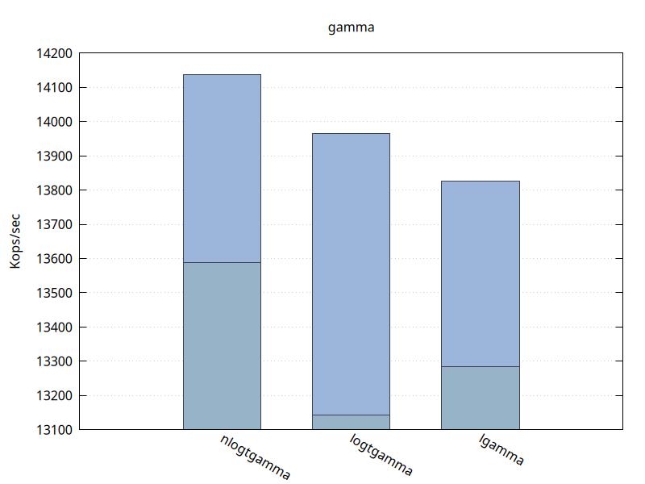
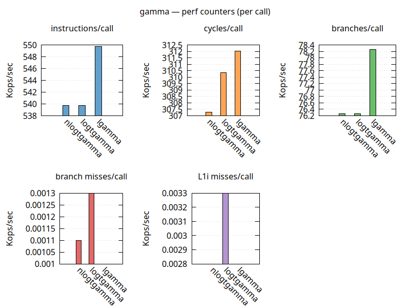

* zmida -- zig benchmarking harness

Microbenchmarks for high-performance, CPU-bound code.

- zero, one, or many function arguments; same inputs to every function compared
- inputs from slices, arrays, single tuples, or generators
- trials by count, by time, or adaptive (default)
- TSC timing (invariant TSC required), falls back to =clock_gettime=
- perf_event counters: instructions, cycles, branches, L1i, L1d, LL
- output: text tables, CSV, gnuplot
- CPU pinning, priority, command line switches
- =bench()= one-liner, or =Study= for full control

Each function gets a warmup, then a series of timed samples. Perf counters are
collected in a separate run so they never disturb the timing samples.
Walkthrough: [[./HOWTO.org][HOWTO.org]].

* Requirements

- Zig 0.17.0 or later
- Linux x86-64 only (cpuid/rdtsc, affinity, priority, perf_event_open)
- Perf counters: =kernel.perf_event_paranoid <= 2= and a visible PMU (most VMs hide it)
- Build with =-Doptimize=ReleaseFast= (or ReleaseSafe); zmida warns in Debug

* Install

#+BEGIN_SRC sh
zig fetch --save <url-of-this-repo>
#+END_SRC

#+BEGIN_SRC zig
// build.zig
const zmida = b.dependency("zmida", .{ .target = target, .optimize = optimize });
exe.root_module.addImport("zmida", zmida.module("zmida"));
#+END_SRC

* Quick start

#+BEGIN_SRC zig
const std = @import("std");
const zm = @import("zmida");

pub fn main(init: std.process.Init) !void {
    const args = zm.gen.uniform(f64, 100, 0, 10, 0);
    try zm.bench(&init, .{ logtgamma, lgamma }, &args);
}

fn lgamma(x: f64) f64 {
    return std.math.lgamma(f64, x);
}

fn logtgamma(x: f64) f64 {
    return std.math.log(f64, std.math.e, std.math.gamma(f64, x));
}
#+END_SRC

=bench= runs every function over every argument and prints a latency table.

* Study: choose trial type, options, outputs

#+BEGIN_SRC zig
// example/readme.zig
pub fn main(init: std.process.Init) !void {
    const funcs = .{ nlogtgamma, logtgamma, lgamma };
    const args = zm.gen.uniform(f64, 100, 0, 10, 0);

    zm.init(&init, .{ .pin_cpu = 1, .perf_cpu = true });
    var study = try zm.Study.run("gamma", .byadapt(.{}), funcs, &args);
    defer study.deinit();

    try study.write_text(null, .{ .mode = .thru });
    try study.write_gnuplot("", .{});      // gamma.gp
    try study.write_gnuplot_perf("", .{}); // gamma-perf.gp
}
#+END_SRC

Results go to stdout, progress to stderr:

#+BEGIN_EXAMPLE
study: gamma
compile: .ReleaseFast
units: Mops/sec
clock: .tsc @ 1497600000 Hz
display: throughput (higher is better)

fn          |      calls  seconds    mean |   best     p75     p50     p25   worst
------------+-----------------------------+---------------------------------------
nlogtgamma  |   28280000     2.01   14.04 |  14.28   14.14   14.07   13.95   13.52
logtgamma   |   26920000     1.93   13.92 |  14.25   14.08   14.00   13.85   13.00
lgamma      |   27430000     1.98   13.86 |  14.08   13.96   13.89   13.78   13.30

fn          |    ipc      insts     cycles    imiss |  miss/M     misses   branches
------------+---------------------------------------+------------------------------
nlogtgamma  |  1.798      548.8      305.1    0.002 |   12.04      0.001       76.3
logtgamma   |  1.796      548.8      305.6    0.003 |   18.30      0.001       76.3
lgamma      |  1.806      558.8      309.4    0.003 |   47.79      0.004       78.3
#+END_EXAMPLE

* Command line switches

Accepted by any program that calls =zm.init= or =bench=; they override the code.
Form is =-x=value= (not =-x value=). Unknown =-= arguments are rejected.

| switch                 | meaning                                         |
|------------------------+-------------------------------------------------|
| =-v=, =--verbose[=N]=  | 0 silent, 1 normal (default), 2 trace; bare =-v= is 2 |
| =-t=, =--tsc[=B]=      | TSC timing, =on= (default) / =off=              |
| =-c=, =--cpu=N=        | pin to cpu N                                    |
| =-n=, =--nice=N=       | niceness -20..19 (negative needs root)          |
| =-p=, =--perf=WHAT=    | =cpu=, =mem=, =both= (default: none)            |

* Examples

| file          | shows                                                   |
|---------------+---------------------------------------------------------|
| =simple.zig=  | =bench()= with one function and with several            |
| =basic.zig=   | =Study=, perf counters, throughput output               |
| =full.zig=    | SIMD division variants, all outputs                     |
| =gendata.zig= | multi-argument functions, =gen.tie=, =gen.LinSpace=     |
| =loop.zig=    | functions with their own inner loop; =work_units=, =dno= |
| =plots.zig=   | gnuplot; direct vs function-pointer vs method calls     |
| =readme.zig=  | the code above                                          |

#+BEGIN_SRC sh
zig build examples -Dexamples=true --release=fast        # build all
zig build run-basic -Dexamples=true --release=fast -- -c=1 -p=cpu
#+END_SRC

* Concepts

- *Call*: one invocation on one argument (tuple).
- *Sweep*: one pass over the argument list.
- *Sample*: one or more whole sweeps, timed. The unit all statistics derive from.
- *Trial*: one function, all of its samples.
- *Study*: trials of several functions sharing configuration and inputs.

* Testing

#+BEGIN_SRC sh
zig build test
#+END_SRC

Some tests touch hardware (TSC, =/sys= cpufreq, affinity, priority) and may
fail in VMs or containers.

* Known issues

- Floating-point generators (=gen.LinSpace=) spill their loop state around calls
  to non-inlined functions (e.g. libm =log= via PLT); =gen.Range= compiles to the
  same code as a plain loop. For FP-sensitive work pass a materialized array.
- No baseline (empty function) subtraction; benchmark a no-op yourself (HOWTO 2.7).

* Future

- better gnuplot output
- baseline subtraction (after v1)

* AI

Models were used for code review, debugging, gnuplot code and files,
documentation, and test generation.

* License

BSD 2-Clause. See [[./LICENSE][LICENSE]].
